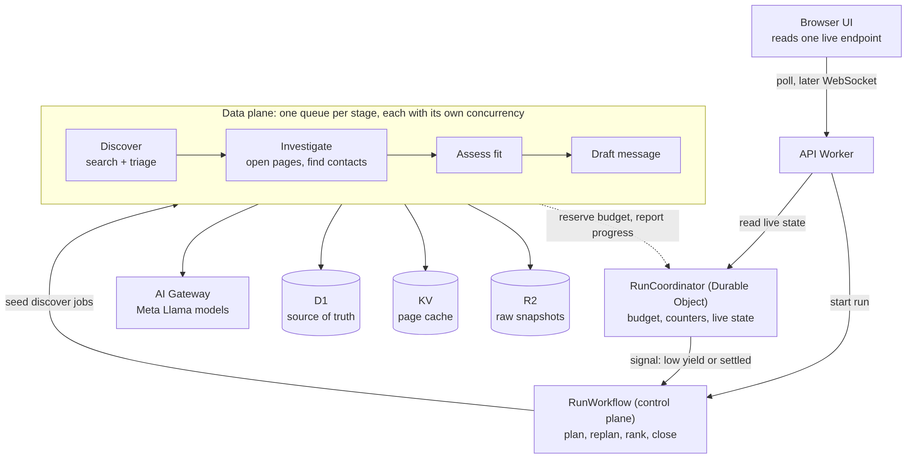

# Prospect Research: Cloudflare architecture for speed and live progress

Status: proposal for the implementing agent. Written from the run transcript (run_71a74ac3), not from the source code, so every claim about the code is marked "verify" where the agent must check it first.

---

## 1. Verdict

The product logic is fine. The shape of the pipeline is the problem.

Your agent's diagnosis (serial discovery, batch barriers, N+1 reads, serial model calls, retry storm) is right. Two things it did not name:

1. **Phases act as barriers.** The run does discover for everything, then investigate for everything, then assess for everything, then draft for everything. The user sees nothing until a phase ends, and one slow website holds up every item behind it. This is the real mistake. It is the opposite of a GenStage pipeline, where each item flows to the next stage the moment it is ready.
2. **Discovery is probably an LLM tool loop.** The audit log shows 13 to 31 seconds per search, which is model latency, not search latency. If a model decides each next search, 20 to 35 searches run one after another. Verify this first, because fixing it is the single biggest win.

Target after the full rework (estimates, not measured): first match visible in under 90 seconds, a 40-business run finished in about 2 to 4 minutes, down from 15+ minutes.

---

## 2. What is wrong, ranked by time cost

| # | Mistake | Evidence in your run | Fix |
|---|---|---|---|
| 1 | Phases are barriers | UI sat at "83 of 90" with 0 or 1 kept for many minutes | Per-prospect pipeline joined by queues (section 4) |
| 2 | Discovery is a serial LLM loop | 20 searches in sweep 1 (19:42:49 to 19:45:14), 15 more in sweep 2 | Model plans queries once. Code runs searches in parallel. A small model triages results in batches |
| 3 | Investigate drains in batches of 5 | Each batch costs as much as its slowest site (3 to 20 s) | Sliding window, plus fan-out across invocations (the 6-connection limit is per invocation) |
| 4 | Assess, rank and draft call the model one prospect at a time | 5 to 15 s each, dozens of prospects | Queue consumers with bounded concurrency, behind AI Gateway |
| 5 | N+1 reads | `listEvidence` per prospect, plus a SELECT per social route | Query by prospect id, or load once per stage |
| 6 | Budget exhaustion thrown as an error inside a Workflow step | 5 retries with backoff, about 10 minutes of apparent freeze (already patched, but the pattern remains) | Budget is state in a Durable Object. Running out is a normal outcome, never an exception |
| 7 | Progress is phase-level and polled from D1 | User cannot tell working from stuck | Durable Object holds live counters. UI shows per-stage counts and streams first results |
| 8 | Junk enters the pipeline | "HOTELS", "INDEPENDENT", "NOTICE OF ANNUAL GENERAL MEETING", a `.cdr` file as a business | Cheap triage before any page is opened. Replan on low yield after the first 10 assessed, not after a full sweep |
| 9 | Every set-aside reason reads "Did not pass your must-haves." | Screenshot text | Specific one-line reasons ("Looks like a social club, not an event business") |

---

## 3. Design principles

1. **Control plane and data plane.** The Workflow decides what happens and in what order (plan, replan, rank, close). Queues and Workers do the heavy repeated work. Do not run 90 prospects through Workflow steps.
2. **Pipeline, not phases.** Each prospect moves independently: found, opened, checked, shortlisted or set aside, drafted.
3. **Demand-driven with back pressure.** Each stage has its own queue. The queue is the buffer. `max_concurrency` on each consumer is the demand control. A slow stage never blocks a fast one, and a flood in discovery cannot overwhelm the model stage.
4. **State lives on the server. A page load only reads.** Refreshing, leaving and returning never starts or restarts work.
5. **Budget is data, not control flow.** Reserve before you spend. When it runs out, stop enqueuing and let the run settle with what exists.
6. **Idempotent handlers.** Every message can be delivered twice. Guard with a state transition (`UPDATE ... WHERE state = expected`).
7. **Show first value early.** The user can start approving messages while research continues.

---

## 4. Target architecture



Flow in words:

1. The API Worker creates the run, initialises a `RunCoordinator` Durable Object, and starts `RunWorkflow`.
2. `RunWorkflow` calls the model once to plan (ICP, must-haves, 8 to 20 search queries), then enqueues one `discover` message per query.
3. `discover` consumers call the search API directly, in parallel. A small Llama model triages result titles and URLs in batches of about 20 and drops junk. Survivors are upserted into D1 (deduped) and enqueued to `investigate`.
4. `investigate` consumers reserve budget in the Durable Object, fetch the home page plus up to two relevant pages (contact, about) with a hard timeout, extract text, find and validate contact routes, store evidence, and enqueue `assess`.
5. `assess` consumers ask the model whether the business fits the must-haves, using the evidence, and return structured JSON with a plain-English reason. Fit goes to `draft`. Not fit is set aside with that reason.
6. `draft` consumers write the message and mark the prospect `drafted`.
7. Every stage reports to the Durable Object, which the UI reads. When nothing is in flight, or the target is reached, or the budget is spent, the Durable Object signals the Workflow.
8. The Workflow ranks, closes the run as `awaiting_approval`, and the user reviews. Sending already uses your existing delivery queue.

---

## 5. Which Cloudflare primitives, and do you need them

| Primitive | Need it? | Role | When |
|---|---|---|---|
| **Workflows** | Keep | Control plane for one run: plan, wait for signal, replan, rank, close. Small number of steps | Already in use |
| **Queues** | Yes (new queues) | One queue per stage: `research-discover`, `research-investigate`, `research-assess`, `research-draft`, plus a dead letter queue. This is your GenStage. You already bind `DELIVERY_QUEUE`, so the platform is on your account | Phase 2 |
| **Durable Objects** | Yes (new) | `RunCoordinator`, one per run. Single-threaded, so budget reservations and counters are atomic. Holds live progress and serves the UI. Wakes the Workflow | Phase 1 |
| **D1** | Keep | System of record: runs, prospects, evidence extracts, drafts, audit log. Keep writes small and use `batch()`. Watch the 10 GB per-database ceiling you already hit in the video pipeline | Already in use |
| **KV** | Yes, small | Page cache keyed by URL hash with a TTL of about 7 days, so repeat runs on the same segment skip fetches. Also robots and domain failure flags. Do not use it for progress (eventual consistency) | Phase 3 |
| **R2** | Optional | Raw HTML snapshots as proof for each claim, and CSV exports. Store a pointer in D1. Not needed for speed | Phase 3 or later |
| **AI Gateway** | Yes (you already have it) | Route every Meta model call through it: retries, rate limiting, caching of identical prompts, per-stage cost and latency analytics | Phase 0 to 1 |
| **Workers AI or Meta API** | Keep | Meta models. Use a small fast Llama for triage and fit checks, a larger Llama for drafting and planning. Check the model list at build time rather than trusting names here | Verify |
| **Cron triggers** | Keep | Your `*/5 * * * *` sweep becomes a safety net that finds runs with no heartbeat and nudges them | Phase 2 |
| **Analytics Engine** | Optional | Per-stage duration and failure counts. Cheaper to start with an `audit_log` row per stage including `duration_ms` | Phase 3 |
| **Browser Rendering** | No | Only worth adding for JavaScript-only sites after you have measured how many fail plain fetch | Later |
| **Vectorize** | No | Not needed for dedupe. A normalised domain and name key in D1 is enough | No |

---

## 6. Stage specification

All numbers are starting values to tune against measurements.

| Stage | Input | Work | Consumer settings | Timeout | On failure |
|---|---|---|---|---|---|
| plan (Workflow step) | brief | One model call: ICP, must-haves, queries | n/a | 60 s | Workflow retry, 3 times |
| discover | one query | Call search API. Triage results with small Llama (batch of about 20). Upsert deduped prospects. Enqueue investigate | batch 1, concurrency 6 | 20 s | Retry 3 times, then record "search failed" and carry on |
| investigate | one prospect | Reserve budget. Fetch up to 3 pages, at most 3 at once. Extract text. Find contact routes. Validate links. Save evidence | batch 3, concurrency 8 (about 24 sites at once) | 8 s per page, 25 s total | Mark `failed_soft` with reason "Could not open their website". Never retry a timeout more than once |
| assess | one prospect | Small Llama, JSON schema out: `fit`, `reason`, `evidence_ids`, `score` | batch 4, concurrency 6 | 30 s | Retry with backoff. After 3, set aside with reason "Could not check fit" |
| draft | one shortlisted prospect | Larger Llama writes the message, grounded in evidence | batch 2, concurrency 4 | 45 s | Retry 3 times, then leave as `shortlisted` and flag "draft failed, retry" |
| rank (Workflow step) | all shortlisted | Deterministic score first, model only for ties | n/a | 60 s | Retry |

Why small batches: the limit of 6 simultaneous outbound connections applies per request (per invocation), so a consumer handling 100 messages in one invocation is still limited to 6 at a time. Parallelism comes from many invocations (`max_concurrency`) each doing a few things, not from one invocation doing many.

---

## 7. `RunCoordinator` Durable Object

One per run id. Use a SQLite-backed Durable Object so state survives eviction. It is a derived view: D1 stays the source of truth, and the coordinator can rebuild its counters from D1 if it is ever empty.

State:

```
budget:   { searches: {cap, used}, fetches: {cap, used}, modelCalls: {cap, used} }
counts:   { found, triagedOut, opened, failedSoft, assessed, shortlisted, setAside, drafted }
inflight: { discover, investigate, assess, draft }
flags:    { discoveryEnqueued, closing, firstReadyAt, replans }
recent:   last 30 human-readable events (ring buffer)
```

Methods (Durable Object RPC):

- `reserve(kind, n)`: returns true and increments if within cap. Returns false when spent. Handlers treat false as "skip and ack", never as an error.
- `started(stage)` and `finished(stage, outcome)`: update inflight and counts. After each call run `maybeSignal()`.
- `maybeSignal()`: sends one event to the Workflow when any of these becomes true: (a) inflight is 0 and discovery is fully enqueued, (b) drafted reaches the target, (c) budget spent and inflight is 0, (d) yield after the first 10 assessed is below 20 percent and replans is under 2 (signal `low_yield`).
- `live()`: returns the snapshot the UI reads (section 10).
- `close()`: sets `closing`. Handlers check this and ack-and-skip remaining work.

Event signalling: `env.RUN_WORKFLOW.get(runId).sendEvent({ type: "run.signal", payload: { kind } })`. Use a single event type with a `kind` field so the Workflow needs only one `waitForEvent`.

---

## 8. `RunWorkflow` (control plane)

Keep it to roughly 6 steps. Never return large data from a step (1 MiB result limit). Write to D1 and return ids.

```
step.do("plan")                       -> queries[], mustHaves[], target
step.do("seed")                       -> init coordinator, enqueue discover jobs
loop:
  signal = step.waitForEvent("run.signal", { timeout: "10 minutes" })
  if kind == "low_yield": step.do("replan") -> enqueue more discover jobs (max 2 times)
  if kind == "settled" or timeout: break
step.do("rank")
step.do("close")                      -> status awaiting_approval, notify
```

Fallback if `waitForEvent` misbehaves: `step.sleep("10 seconds")` then read `coordinator.live()` in a step, and break when settled. Slightly less elegant, equally durable.

Limits that matter (Workers Paid, per current docs): 10,000 steps per instance by default, 50,000 concurrent running instances per account, 30 s CPU per step by default, 10,000 subrequests per request by default, 1 MiB per step result. Waiting and sleeping instances do not count towards concurrency.

---

## 9. Data model changes (D1)

```sql
-- one row per prospect, explicit state machine
ALTER TABLE prospects ADD COLUMN state TEXT NOT NULL DEFAULT 'found';
  -- found | opened | shortlisted | set_aside | drafted | failed_soft | triaged_out
ALTER TABLE prospects ADD COLUMN reason TEXT;            -- plain English, shown to the user
ALTER TABLE prospects ADD COLUMN domain_key TEXT;        -- normalised host, for dedupe
ALTER TABLE prospects ADD COLUMN stage_ms TEXT;          -- JSON of per-stage durations
CREATE UNIQUE INDEX IF NOT EXISTS ux_prospect_dedupe ON prospects(run_id, domain_key)
  WHERE domain_key IS NOT NULL;
CREATE INDEX IF NOT EXISTS ix_prospect_state ON prospects(run_id, state);
CREATE INDEX IF NOT EXISTS ix_evidence_prospect ON evidence(prospect_id);
```

Transitions are guarded: `UPDATE prospects SET state = ? WHERE id = ? AND state = ?` and a handler that matches zero rows does nothing. Adjust column and table names to the real schema (verify).

Junk rules at insert (pure function, unit tested, runs before any model call): reject names that are all caps single generic words ("HOTELS", "INDEPENDENT"), file-like names (`.cdr`, `.pdf`), names starting with "NOTICE OF", "How We", "Again,", news-style sentences longer than about 8 words, and directory or listing domains you already know. Then a small model triage handles the rest in batches.

---

## 10. Progress and UX contract

The UI reads one endpoint and never starts work on load:

`GET /api/runs/:id/live` returns

```json
{
  "status": "working",
  "stages": { "found": 56, "opened": 31, "assessed": 22, "shortlisted": 6, "setAside": 16, "drafted": 4 },
  "skipped": { "notBusinesses": 9, "couldNotOpen": 3 },
  "firstReady": true,
  "recent": ["Opened Korex Events", "Set aside Ikeja Club: social club, not an event business"],
  "settled": false
}
```

Start with polling every 2 seconds (works with your existing `pollProgress`). Move to WebSocket from the Durable Object later.

What the user reads (plain language, per the style guide):

| Stage | Copy |
|---|---|
| found | Looking for businesses (56 found) |
| opened | Reading their websites (31 of 56) |
| assessed | Checking they fit what you sell (22 of 31) |
| drafted | Writing your messages (4 ready) |
| skipped | Skipped 9 results that were not real businesses |

Rules:

- Replace the single "83 of 90" bar with the four stage counts above, so something always moves.
- As soon as `drafted` is 1 or more, the dashboard hero changes to "4 messages are ready. 12 more are being written." with the button "Check the 4 ready messages". Research continues in the background. This removes the wait for the user.
- If nothing has changed for 60 seconds and work is in flight, show "Still working. Some websites are slow." Never show a bare spinner.
- The dashboard button is already state-aware (working goes to progress, ready goes to messages). Keep that.
- "Kept so far" must count shortlisted and drafted, not an investigate-time default (this was the open counter quirk in `progress.md`).

---

## 11. Config sketch (`wrangler.jsonc`)

Illustrative. Check key names against current Wrangler docs before applying.

```jsonc
{
  "name": "prospect-research",
  "durable_objects": { "bindings": [{ "name": "RUN", "class_name": "RunCoordinator" }] },
  "migrations": [{ "tag": "v2", "new_sqlite_classes": ["RunCoordinator"] }],
  "queues": {
    "producers": [
      { "queue": "research-discover",    "binding": "Q_DISCOVER" },
      { "queue": "research-investigate", "binding": "Q_INVESTIGATE" },
      { "queue": "research-assess",      "binding": "Q_ASSESS" },
      { "queue": "research-draft",       "binding": "Q_DRAFT" },
      { "queue": "delivery-jobs",        "binding": "DELIVERY_QUEUE" }
    ],
    "consumers": [
      { "queue": "research-discover",    "max_batch_size": 1, "max_concurrency": 6, "max_retries": 3, "dead_letter_queue": "research-dlq" },
      { "queue": "research-investigate", "max_batch_size": 3, "max_concurrency": 8, "max_retries": 2, "dead_letter_queue": "research-dlq" },
      { "queue": "research-assess",      "max_batch_size": 4, "max_concurrency": 6, "max_retries": 3, "dead_letter_queue": "research-dlq" },
      { "queue": "research-draft",       "max_batch_size": 2, "max_concurrency": 4, "max_retries": 3, "dead_letter_queue": "research-dlq" },
      { "queue": "delivery-jobs" }
    ]
  },
  "kv_namespaces": [{ "binding": "PAGE_CACHE", "id": "<create with wrangler kv namespace create>" }],
  "r2_buckets": [{ "binding": "EVIDENCE", "bucket_name": "prospect-evidence" }],
  "limits": { "cpu_ms": 60000 }
}
```

Queue facts to respect: messages up to 128 KB (send ids, never page text), batches up to 100, up to 100 retries, about 2,100 messages per second per queue. Use `msg.retry({ delaySeconds })` for transient errors and `msg.ack()` for permanent ones so they do not loop.

---

## 12. Code sketches (illustrative, not compiled)

### 12.1 Sliding window (this is the Phase 0 change; tested in `pool.test.mjs`)

```ts
export async function mapPool<T, R>(
  items: readonly T[], limit: number, fn: (item: T, i: number) => Promise<R>,
): Promise<PromiseSettledResult<R>[]> {
  const out: PromiseSettledResult<R>[] = new Array(items.length);
  let next = 0;
  const worker = async () => {
    for (;;) {
      const i = next++;
      if (i >= items.length) return;
      try { out[i] = { status: "fulfilled", value: await fn(items[i], i) }; }
      catch (reason) { out[i] = { status: "rejected", reason }; }
    }
  };
  await Promise.all(Array.from({ length: Math.min(limit, items.length) }, worker));
  return out;
}
```

A slot refills the moment any task finishes. There is no barrier, and one failure never cancels the others.

### 12.2 Fetch with a hard timeout that covers the body

```ts
export async function fetchText(url: string, ms = 8000): Promise<{ ok: boolean; status: number; text: string }> {
  const ctl = new AbortController();
  const timer = setTimeout(() => ctl.abort(), ms);
  try {
    const res = await fetch(url, { signal: ctl.signal, redirect: "follow", headers: { "user-agent": "ProspectResearchBot/1.0" } });
    const text = res.ok ? (await res.text()).slice(0, 400_000) : "";
    return { ok: res.ok, status: res.status, text };
  } finally { clearTimeout(timer); }   // clear only after the body is read
}
```

### 12.3 Stage handler shape (every stage looks like this)

```ts
export default {
  async queue(batch: MessageBatch<InvestigateMsg>, env: Env) {
    await mapPool(batch.messages, 3, async (msg) => {
      const { runId, prospectId } = msg.body;
      const run = env.RUN.get(env.RUN.idFromName(runId));
      if (await run.isClosing()) return msg.ack();
      if (!(await run.reserve("fetches", 3))) return msg.ack();       // budget spent: skip, not an error
      try {
        const moved = await transition(env.DB, prospectId, "found", "opening");
        if (!moved) return msg.ack();                                  // duplicate delivery
        // ... fetch, extract, save evidence ...
        await transition(env.DB, prospectId, "opening", "opened");
        await env.Q_ASSESS.send({ runId, prospectId });
        await run.finished("investigate", "ok");
        msg.ack();
      } catch (e) {
        await run.finished("investigate", "error");
        isTransient(e) ? msg.retry({ delaySeconds: 10 }) : (await markFailedSoft(env.DB, prospectId, e), msg.ack());
      }
    });
  },
};
```

---

## 13. Phased plan, acceptance criteria and deploy rules

Deadline note: your agent said the hackathon deadline is 9 PM ET today. If so, that is about 03:00 Lagos time. Judges may open the live URL after you submit, so a run that looks frozen is a real risk, and so is a broken deploy. Both are managed below.

### Deploy rules for every phase

- One change per commit and per deploy. Tag the current good version first (`git tag pre-speed`) and note the Worker version id so `wrangler rollback` is one command.
- Each change must pass `npm test`, `npm run typecheck` and `node tests/smoke.mjs` before deploy. After each edit, re-read the diff and look for duplicated or leftover lines. In the transcript the agent had to fix its own bogus second `phase()` call, so keep edits small.
- Workflow instances pin the version they started on, so running instances are unaffected by a deploy. New runs use the new code. Test with a new run, not the pinned one.
- Freeze deploys 60 minutes before the deadline. Record the demo from a completed run (below) rather than a live one.

### Phase 0: safe speed-ups, tonight, only after the demo is recorded (about 60 to 90 minutes)

| Step | Change | Done when |
|---|---|---|
| 0.1 | Replace the batch-of-5 `Promise.allSettled` in investigate with `mapPool(limit 6)` and add `fetchText` with an 8 s hard timeout | Same Ikeja brief: page-open phase finishes noticeably faster, same number of prospects opened |
| 0.2 | Fix N+1: one `SELECT ... WHERE prospect_id = ?` (or load all evidence for the run once into a Map) | No per-prospect full-run evidence read in the code path |
| 0.3 | `mapPool(limit 4)` for assess and draft model calls | Faster, and no model rate-limit errors in the logs. Raise to 6 only if clean |
| 0.4 | Rule-based junk filter and domain dedupe at save time, with unit tests using the real junk names from your run | "HOTELS", "INDEPENDENT", "NOTICE OF ANNUAL GENERAL MEETING" and `.cdr` never reach investigate |
| 0.5 | Specific set-aside reasons from the assess output | No two different businesses share the identical generic reason |
| 0.6 | If search is a plain API call, run discovery queries with `mapPool(limit 6)` instead of one model turn per search | Discovery time falls from minutes to well under a minute. If search can only be reached through the model's tool loop, skip this and do it in Phase 1 |

Demo safety net: keep one finished run for the recording. Do not start a fresh research run on camera unless it has completed at least once on the new build.

### Phase 1: live state (day 1 after submission)

Build `RunCoordinator` (budget, counters, `live()`), add `/api/runs/:id/live`, switch the progress view to it, add the "first messages ready" hero state, and fix the "kept so far" counter. Acceptance: refresh at any moment resumes the same view; the hero switches to "N messages are ready" while research is still running.

### Phase 2: pipeline (days 2 and 3)

Add the four queues and the dead letter queue, move each stage into a consumer, shrink the Workflow to the six control steps in section 8, add yield-based replan, and keep cron as a safety net. Acceptance: a 40-business run reaches its first draft in under 90 seconds and settles in under 4 minutes; killing a consumer mid-run loses nothing; a duplicate message changes nothing.

### Phase 3: polish

KV page cache, R2 evidence snapshots, AI Gateway caching and per-stage limits, per-stage timing in `audit_log`, and a load test with five simultaneous runs. Acceptance: a repeat run of the same segment is at least 30 percent faster from cache; five parallel runs all settle.

---

## 14. How to measure (fill in before and after)

Log one `audit_log` row per stage with `duration_ms`. Report these for the Ikeja grills and drinks brief:

| Metric | Before | Phase 0 | Phase 2 target |
|---|---|---|---|
| Time to first candidate | | | under 15 s |
| Time to first shortlisted | | | under 60 s |
| Time to first draft | | | under 90 s |
| Time to settled (about 40 businesses) | over 15 min | | under 4 min |
| Pages opened per minute | | | 4x or better |
| Model calls per run | | | no more than before |

Back-of-envelope for the target (an estimate to sanity check, not a measurement): 20 searches at concurrency 6 take about 4 waves of 3 s, one triage call about 5 s, 60 sites at roughly 24 in flight with an 8 s cap take about 20 to 30 s, 40 assessments at concurrency 6 take about 40 s, and 15 drafts at concurrency 4 take about 25 s. Overlapping stages brings the total to roughly 2 minutes.

---

## 15. Verify before building

1. Is discovery an LLM tool loop, or can the search API be called directly from code? This decides how much Phase 0.6 gains.
2. Which model and endpoint are used for each call (Workers AI or Meta's API through AI Gateway)? Check rate limits for the chosen model before setting concurrency.
3. Do parallel `step.do` calls inside one Workflow get independent outbound connection pools? This matters only if you choose Workflow steps over queues. The queue design avoids the question.
4. D1 write behaviour under parallel consumers. Keep writes tiny and batched. If you see `SQLITE_BUSY` or slow writes, move hot counters to the Durable Object only and write to D1 less often.
5. Exact Wrangler keys for queue consumer concurrency and dead letter queues on your Wrangler version.
6. Terms of the sites being fetched: honour `robots.txt` and rate-limit per domain (cache in KV).

---

## Sources

- [Workflows limits](https://developers.cloudflare.com/workflows/reference/limits/)
- [Workers limits](https://developers.cloudflare.com/workers/platform/limits/)
- [Queues limits](https://developers.cloudflare.com/queues/limits)
